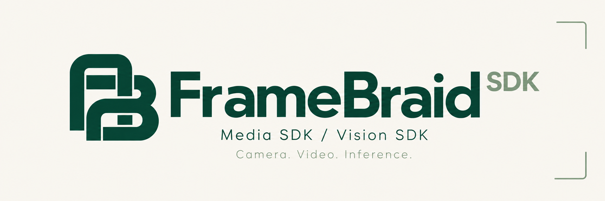
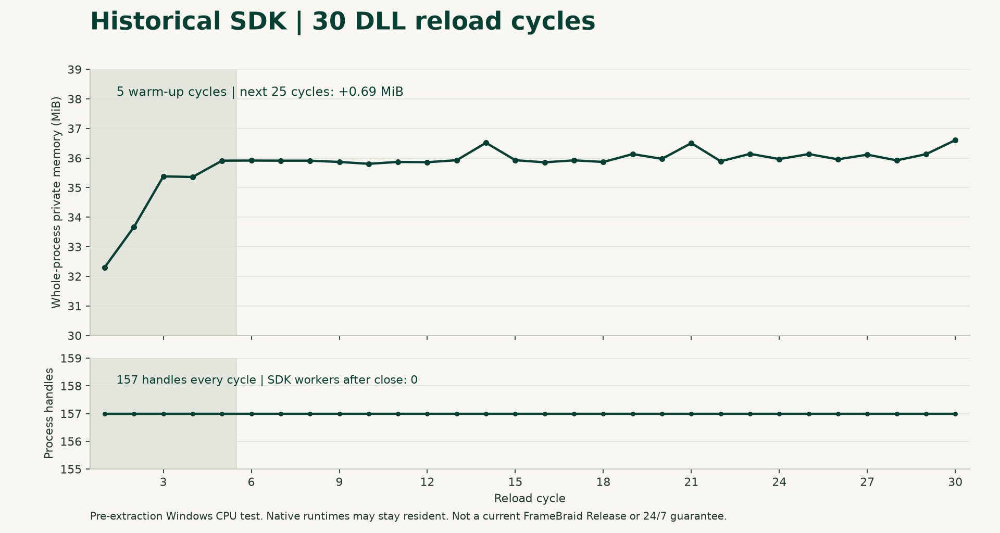

# FrameBraid SDK



[简体中文](README.zh-CN.md) · [Documentation](docs/README.md) · [Getting started](docs/GETTING_STARTED.md) · [Roadmap](docs/ROADMAP.md)

[](https://github.com/xiaoyanse/framebraid/actions/workflows/ci.yml) [](https://github.com/xiaoyanse/framebraid/releases) [](LICENSE)

**Reusable camera, video and ONNX inference building blocks for native applications.**

FrameBraid is a Rust source SDK with a C ABI for C, C++, C# and Python. One repository contains two components:

| Component | Purpose |
| --- | --- |
| **FrameBraid Media SDK** | ISAPI images, RTSP encoded streams, decoded frames, standalone decoding and pixel conversion |
| **FrameBraid Vision SDK** | ONNX execution, bounded asynchronous work, raw tensors, profile-based postprocessing, and multi-model orchestration via the inference pool |

**Status: v0.7.0.** [Releases](https://github.com/xiaoyanse/framebraid/releases). C ABI moves to **1.4 as a compatible addition** (v0.7.0: **inference pool orchestration API — one call loads k shard models with a prebuilt lane→shard mapping; borrowed handles work with the existing infer family as-is; 8-lane GPU-direct dual-shard measured 194.8 items/s ≈ 97% of 8×25 fps demand**; plus a batching registry TOCTOU race fix); the validated target is **Windows x64 CPU + hardware-decode probing** — the 8-lane figure is a GPU research measurement on the release machine (RTX 5060, CUDA ORT), see the [integration guide](sdk/INTEGRATION.md); Linux/macOS/mobile binaries and formal GPU inference acceptance are separate. See [validation scope](docs/RELEASE_STATUS.md).


## Contents

- [Where it fits](#where-it-fits)
- [Media SDK](#media-sdk)
- [Vision SDK](#vision-sdk)
- [Measured highlights](#measured-highlights)
- [Build from source](#build-from-source)
- [Language integration](#language-integration)
- [Ownership, concurrency and failures](#ownership-concurrency-and-failures)
- [Validation and boundaries](#validation-and-boundaries)
- [Test observations](#test-observations)
- [Contribute and report](#contribute-and-report)
- [License](#license)

## Measured highlights

All figures come from recorded, reproducible runs on the release machine (Windows 11 x64, Intel Arc 140T + RTX 5060, CPU-only ONNX Runtime); see [validation status](docs/RELEASE_STATUS.md) for scope and links to raw records.

| Area | Measured result |
| --- | --- |
| Rust regression | 528 tests passing; clippy/fmt clean; source-fingerprint gate 291 files |
| ROI cascade (downstream-measured) | Small-object score 0.167 → 0.461, boxes 7 → 15 via ROI upscaling, not whole-frame resolution |
| Open-vocabulary e2e | bind → auto-injection → within-entry merge → hits/labels → re-bind, all asserted over real ORT (synthetic dual models) |
| Hardware decode matrix | H.264/H.265 360p–4K (incl. Main10) all D3D11VA-verified with software controls |
| Keyframe resync | Dropping a GOP prefix resumes exactly at the next IDR under both policies |
| RTSP fault handling | Stream-loss resume, in-flight close, bounded drain — 4/4 cases |
| FILE seek (real FFmpeg) | Three seek modes, EOF revival, loop replay and EXACT filter integration green |
| NV12 conversion (1080p) | 8.8 → 6.8 ms/frame (−23%) with bit-exact output (2⁴⁸² exhaustive parity) |
| Sampling cadence | 30 fps input effective delivery ≈ 29.5 fps (was ~16 before cadence fix) |
| Tensor direct write | −4.9 MB temporary allocation per 640×640 preprocess |
| Shared-frame pool | borrow P50 ≈ 22 µs, return ≈ 25 µs, publish ≈ 1 ms at 1080p |
| Explicit copy (1080p) | C# P50 ≈ 1 ms; Python ≈ 2.5–3.8 ms |
| Adaptive batching | Six-scenario real-ORT suite passed; off by default |
| Inference pool (8-lane GPU-direct, research rig) | 194.8 items/s ≈ 97% of 8×25 fps demand, zero rejections (dual-shard, batch-4, RTX 5060 + CUDA ORT) |
| Package validation | C/C++17/C#/Python examples run from the clean unpacked package |

Honest negatives are kept too: under the CPU-RGBA readback contract, hardware decode did **not** reduce process CPU time on the test GPUs (1/2/4 lanes consistent) — see [validation](docs/RELEASE_STATUS.md) before choosing backends.

## Where it fits

- Add camera acquisition to a desktop application or an existing Python service.
- Take individual or continuous ISAPI snapshots.
- Receive RTSP packets/frames, or decode H.264/H.265 data already acquired by another system.
- Run compatible ONNX models across languages through one native interface.
- Combine acquisition and inference, optionally sharing frames between trusted local processes.

The host owns device configuration, credential storage, business rules, persistence, alarms and UI. This is not a complete monitoring product, browser player, video editor or safety-certified control system.

## Media SDK

- RTSP H.264/H.265/MJPEG handling; encoded-packet and decoded-frame subscriptions.
- Local FILE source (v0.5.0): MP4 H.264/H.265 playback with EOF and queue draining; **seek (keyframe-before/after, exact), duration, rate and loop** — seek works from the EOF terminal state (playback revival).
- Standalone H.264/H.265 decoding from **complete Annex B access units**. Arbitrary network fragments are not complete-frame inputs.
- ISAPI HTTP Digest snapshots and bounded continuous acquisition. Actual rate depends on the camera and network.
- **Single-frame JPEG/PNG export** (v0.6.0): `amc_frame_encode` encodes any host-held pixel view to evidence bytes — stateless, all pixel formats, capacity-insufficient reports the required size.
- Pull/callback interfaces, bounded queues, metadata, scaling, pixel conversion and reconnect controls.
- Explicit hardware decode probing and automatic backend selection (D3D11VA preferred, DXVA2 where mapped, bounded CPU fallback); per-context worker budgets with live/peak statistics. Hardware readback is not guaranteed faster than CPU; consult the measured contracts.
- Advanced Rust RTSP callers can use `Reader::open_with_budget` and `read_packet_with_budget` to reserve SDK configuration/framing workspace before allocation. Rust callers can also inspect Annex B NAL units with `am_camera::media::codec::visit_access_units` without allocating a NAL list; commit caller state only after overall success.
- Stream probing from explicit endpoints. Rust `CameraEndpoint` generates credential-free ISAPI/main/sub addresses; this helper is not a separate C ABI device-management API.
- Explicit runtime directories and caller-injected credentials; no credential persistence.

Check runtime capabilities and contracts. H.265 decoding does not imply browser H.265 playback.

## Vision SDK

- ONNX Runtime integration, image preprocessing and structured results.
- Five **constrained model profiles**: Pose, Detect, Classify, Segment and OBB.
- **Open-vocabulary binding** (v0.5.0): `amv_vocab_bind` attaches a text-tower embedding table to dual-input detection models; runtime re-binding is atomic, image-path inference auto-injects the cached embeddings, per-box hit details (entry/prompt) support business filtering. Tokenizer pairing stays with the caller.
- **ROI cascade inference** (v0.6.0): `amv_infer_cascade_sync/async` runs full-frame primary detect → ROI generation (static + dynamic rules) → per-ROI crop/upscale → secondary detect → coordinate mapping in one call. Two independent model handles; per-ROI failure skips without failing the batch; `skipped_count` observability; vocab-bound models may serve as the secondary stage.
- **Cross-frame object tracking** (v0.6.0): `amv_tracker_*` — SORT-grade association decoupled from inference; deterministic matching, monotonic never-reused IDs, confirm/TTL semantics, unsmoothed pass-through output. Accepts boxes from any source (detect results, cascade secondary boxes, external detectors).
- Raw named tensor inputs/outputs for custom models within supported dtype/shape contracts.
- Synchronous, asynchronous and batch interfaces, status, notifications, acknowledgement and release.
- **Adaptive batching** (v0.2.0): explicit, bounded, off by default; aggregates AUTO submissions of compatible items on dynamic-batch-axis models into single physical batches. Fixed-batch-axis models are rejected rather than padded. Image items (including the GPU direct-transfer entry, whose preprocessing completes synchronously inside the submission call per §3.3a) participate on par with tensor items; CPU images and GPU frames batch in separate windows (different assembly domains), GPU assembly is device-side (no CPU readback).
- CPU/OpenVINO/CUDA selection with explicit device probing, allowlists and strict/fallback policies, plus layered execution diagnostics. CPU is validated here; other backends need separate dependencies and acceptance.
- Owned pixel inputs across languages: Python `owner.pixels().infer(...)` / C# `owner.Pixels().Submit(...)` keep the owner alive and locked through submission; async inputs use the default copy policy unless retained explicitly.
- Bounded model notification buffers (256 hints, drop-oldest) in Python/C# helpers; retain request IDs to query results after drops.
- Optional shared frames, enabled at build time and explicitly at initialization.

This is not every YOLO version/export. Match the [profile catalog](crates/vision/resources/profiles.json). Model weights and their licenses are separate.

## Build from source

If your downloaded Windows package contains `bin/win-x64`, use the [prebuilt guide](docs/USE_PREBUILT.md) without compiling.

Windows x64: Rust 1.90+, x64 MSVC build tools and Windows SDK. Fetch locked Cargo dependencies on the first build. Node.js/Python are for maintenance tools or Python examples, not prebuilt DLL loading.

Run from the repository root, keeping output outside the checkout:

```powershell
$env:CARGO_TARGET_DIR = (Join-Path $PWD '.local/build/current')
cargo build --workspace --locked
cargo build --release --locked -p am-camera-ffi -p am-vision-ffi --features am-camera-ffi/shared-frames,am-vision-ffi/shared-frames
```

The Release command outputs `am_camera.dll`, `am_vision.dll` and import libraries in `.local/build/current/release`. Historical filenames, `amc_*`/`amv_*` symbols and crate names remain for compatibility; they do not require the original host application.

FFmpeg and ONNX Runtime are dynamically loaded. Pass compatible absolute runtime directories at initialization. A build does not prove runtime availability. See [getting started](docs/GETTING_STARTED.md) for a real-image call and dependency troubleshooting.

## Language integration

| Language | Entry point |
| --- | --- |
| Rust | Local dependencies on `crates/am-camera` and `crates/vision`; not published to crates.io |
| C / C++ | [Media header](sdk/include/am_camera.h), [Vision header](sdk/include/am_vision.h), [examples](sdk/examples/README.md) |
| C# | [Bindings](sdk/bindings/csharp), SafeHandle helpers and examples |
| Python | [Bindings](sdk/bindings/python), standard-library `ctypes` and context managers |

Rust-specific hardware/performance examples live in the repository [`examples/`](examples/) directory; four-language integration examples are under [`sdk/examples/`](sdk/examples/).

Choose static Rust consumption or DLL consumption in one process, not both runtime domains. Java wrappers, Linux/macOS/mobile binaries and GPU-inference acceptance are outside the initial Windows commitment.

## Ownership, concurrency and failures

- Release SDK allocations through the owning SDK, not caller `free`/`delete`.
- Request acknowledgement releases cache responsibility, not acquired result handles.
- Keep callbacks short, retain wrapper references and obey reentrancy restrictions.
- Queues/budgets are bounded: handle rejection, backpressure, stale frames and reconnect generations. No universal FPS, unlimited cameras or lossless delivery is promised.
- Preserve frame identity/timestamps when joining video and results. Display predictions are not new inference results.
- Drain children, callbacks and in-flight work before closing contexts/unloading SDK DLLs. Underlying FFmpeg/ORT may remain process-resident.

See the [integration guide](sdk/INTEGRATION.md) and [ABI contracts](docs/design/dual-dll-abi.md).

## Validation and boundaries

The v0.6.3 Windows x64 release passes **508 workspace Rust tests** (code identical to v0.6.2 — documentation-only release), generator-chain zero-drift checks and source-fingerprint boundary checks (**285 files**). Clean-package validation covers C/C++17/C#/Python examples; cascade and open-vocabulary e2e gates run over real ORT with synthetic dual models (hand-computed coordinate assertions); FILE seek integration runs on real FFmpeg. Hardware decode matrix (H.264/H.265, 360p–4K incl. Main10) is D3D11VA-verified with software controls; RTSP fault matrix (stream-loss resume, in-flight close) passed. New in 0.6.1–0.6.2: batching/image-batching, real-weights open-vocabulary and GPU-pipeline gates run on real hardware (FFI batch e2e, device-side batch assembly vs single runs, real text-tower vocab pipeline, vocab GPU/CPU parity, m2b-repro stability). v0.6.3 adds batching throughput-first guidance (fill-timescale `max_wait_ms`, non-divisible lane trap, `max_wait_ms=0` per-item semantics) retested on driver 621.14 with ORT 1.31/CUDA 13 (8-lane 100% fill 57.9 items/s; 6-lane trap alternation reproduces at 60% of shaped throughput). v0.6.4 adds multi-model ctx budget (staggered execution slot + estimate refinement): CPU-pixel dual-model batch 3/4 unlock with zero rejects (throughput 56.5/20.1; CPU-channel optimum stays batch 2 at 97.7); **GPU-frame dual-model batch 4 = 194.8 items/s with zero rejects (97.4% of the 8-lane 200 demand — effectively full-rate; dev-machine GPU / ORT 1.31 / CUDA 13 / driver 621.14)** — per-channel multi-model guidance in INTEGRATION. Field streams and long-duration acceptance remain registered as unverified. See [status](docs/RELEASE_STATUS.md) and the [v0.6.4 release](https://github.com/xiaoyanse/framebraid/releases/tag/v0.6.4).

The source checkout excludes runtime binaries, weights, credentials, business database and host UI. The separate Windows package includes matching CPU runtimes and their source/license materials. The extraction manifest is historical provenance, not a continuously updated release manifest; core files remain fingerprint-checked.

See [support boundaries](docs/SUPPORT.md), [current local validation](docs/RELEASE_STATUS.md) and [release checklist](docs/RELEASE_CHECKLIST.md). Historical plans do not supersede actual evidence.

## Test observations



| Recorded observation | Result | Scope |
| --- | --- | --- |
| FrameBraid Rust tests | 384 passed; 20 environment-gated skipped | v0.2.0 candidate, Windows x64 Release |
| DLL/script validation groups | Clean-package four-language + batching live suite | v0.2.0 package, CPU and language calls |
| DLL reload cycles | 30; 157 process handles throughout | Historical pre-extraction SDK |
| Post-warm-up process private-memory net growth | 0.69 MiB over 25 cycles | Historical pre-extraction SDK |
| Queue pressure / retained owners | 37 accepted, 14 rejected; 37 retain / 37 release | Historical synthetic CPU test |

Historical figures are not current FrameBraid Release performance; per-run hardware/binary identity is incomplete. No FPS or inference-latency claim is derived. See [data, queue chart and methodology](docs/BENCHMARKS.md).

For current local measurements, use the [reproducible performance tools](docs/PERFORMANCE.md).
Performance acceptance follows [MET-2](docs/PERFORMANCE_ACCEPTANCE.md): CPU offload, useful delivery, latency and recovery have separate goals, and historical verdicts are annotated in the [review record](docs/verification/sdk-metrics-review-20261026.md).

## Contribute and report

Read [CONTRIBUTING.md](CONTRIBUTING.md). Do not post credentials, private stream URLs or customer images. Security reports follow [SECURITY.md](SECURITY.md). See [CHANGELOG.md](CHANGELOG.md).

## License

Copyright 2026 [xiaoyanse](https://github.com/xiaoyanse).

Original SDK code uses [Apache-2.0](LICENSE), allowing commercial and closed-source use subject to its terms. FFmpeg, ONNX Runtime, models and other dependencies retain their licenses. See [NOTICE](NOTICE) and [third-party materials](sdk/third-party/README.md). For choosing between the LGPL-minimal and GPL-encode (libx264) FFmpeg runtimes and the distribution obligations of each, see the [runtime licensing guide](docs/RUNTIME-LICENSING.md).

The ABI 1.5 GPU cascade candidate and validation status are documented in [the integration guide](sdk/INTEGRATION.md#gpu-nv12-级联候选--gpu-nv12-cascade-candidate).
