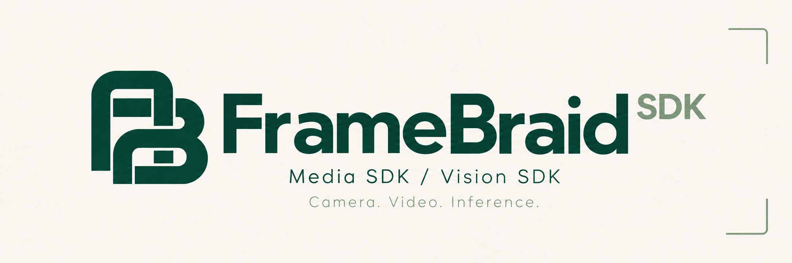
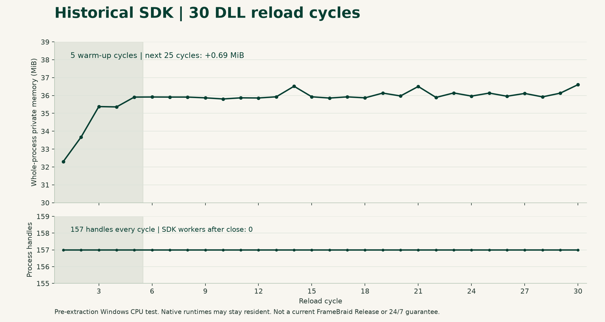

# FrameBraid SDK



[English](README.md) · [文档入口](docs/README.md) · [快速接入](docs/GETTING_STARTED.zh-CN.md)

**可复用的相机接入、视频处理与 ONNX 推理基础组件。**

FrameBraid 是 Rust 源码 SDK，通过 C ABI 供 C、C++、C#、Python 接入，一个仓库管理两个组件：

| 组件 | 用途 |
| --- | --- |
| **FrameBraid Media SDK** | ISAPI 图像、RTSP 编码流、解码帧、独立解码及像素转换 |
| **FrameBraid Vision SDK** | ONNX 执行、有界异步处理、原始张量及模型档案后处理 |

**当前状态：v0.1.0 开发者预览版。**[下载源码与 Windows x64 二进制包](https://github.com/xiaoyanse/framebraid/releases/tag/v0.1.0)。首发已验证范围为 **Windows x64 CPU**；Linux/macOS/移动端二进制及 GPU 验收另行推进，见[验证范围](docs/RELEASE_STATUS.md)。

## 适合用在哪里？

- 给桌面软件或现有 Python 服务增加相机接入。
- 通过 ISAPI 单次截图或连续取图。
- 获取 RTSP 编码包/解码帧，或解码其他系统已取得的 H.264/H.265 数据。
- 在多种语言中通过统一原生接口运行兼容 ONNX 模型。
- 组合采集和推理，按需在可信本机进程间共享帧。

设备配置、凭据保存、业务规则、存储、报警及 UI 由宿主负责。SDK 不是完整监控产品、浏览器播放器、视频编辑器或经过安全认证的控制系统。

## Media SDK

- RTSP H.264/H.265/MJPEG 处理，提供编码包和解码帧订阅。
- H.264/H.265 独立解码，输入为**完整 Annex B 访问单元（AU）**，任意网络分片不能直接当完整帧提交。
- ISAPI HTTP Digest 单次截图及有界连续取图，实际速率受相机和网络影响。
- 拉取/回调接口、有界队列、元数据、缩放、像素转换与重连控制。
- 显式运行库目录、调用方凭据注入，不持久化凭据。
- 按显式地址探测码流。Rust `CameraEndpoint` 可生成不含凭据的 ISAPI/主/子码流地址，不等于 C ABI 已提供独立设备管理 API。

具体能力以运行时查询和合同为准，支持 H.265 解码不代表浏览器可播放 H.265。

## Vision SDK

- ONNX Runtime 接入、图像前处理及结构化结果。
- 五类**限定模型档案**：Pose、Detect、Classify、Segment、OBB。
- 自定义模型的原始命名张量输入/输出，遵循已支持 dtype/形状合同。
- 同步、异步、批量接口，状态、通知、确认与释放。
- CPU/OpenVINO/CUDA 选择及诊断，本轮已验 CPU，其他后端须另备依赖并验收。
- 编译及初始化时显式启用的可选共享帧。

不承诺所有 YOLO 版本/导出配置通用，请匹配[模型档案](crates/vision/resources/profiles.json)。模型权重及其许可分开取得。

## 从源码构建

若下载的 Windows 包已有 `bin/win-x64`，直接按[预编译接入](docs/USE_PREBUILT.md)使用，无需编译。

Windows x64 需要 Rust 1.90+、x64 MSVC 工具链和 Windows SDK，首次取得 Cargo 锁定依赖。维护工具/Python 示例需要 Node.js/Python，直接加载预编译 DLL 不要求安装它们。

在仓库根目录执行，输出放在源码目录之外：

```powershell
$env:CARGO_TARGET_DIR = 'D:/FrameBraid-build'
cargo build --workspace --locked
cargo build --release --locked -p am-camera-ffi -p am-vision-ffi --features am-camera-ffi/shared-frames,am-vision-ffi/shared-frames
```

Release 命令在 `D:/FrameBraid-build/release` 生成 `am_camera.dll`、`am_vision.dll` 及导入库。为兼容现有调用，保留这些文件名、`amc_*`/`amv_*` 符号和 crate 名称，不要求运行原宿主。

FFmpeg、ONNX Runtime 在运行时动态加载，初始化显式传入兼容运行库绝对目录。构建成功不等于运行依赖已可用，真实图片调用及排错见[快速接入](docs/GETTING_STARTED.zh-CN.md)。

## 按语言接入

| 语言 | 入口 |
| --- | --- |
| Rust | 本地依赖 `crates/am-camera`、`crates/vision`，尚未发布到 crates.io |
| C / C++ | [Media 头文件](sdk/include/am_camera.h)、[Vision 头文件](sdk/include/am_vision.h)、[示例](sdk/examples/README.md) |
| C# | [封装](sdk/bindings/csharp)、SafeHandle 辅助及示例 |
| Python | [封装](sdk/bindings/python)、标准库 `ctypes` 与上下文管理器 |

同一进程选择 Rust 静态接入或 DLL 消费域，不重复装配。Java、Linux/macOS/移动端二进制、硬解验收不属于首发 Windows 承诺。

## 内存、并发与故障

- 内存由所属 SDK 释放，不交给调用方 `free`/`delete`。
- 请求确认释放缓存责任，不代替已取得结果句柄的释放。
- 回调保持短小，保留封装引用并遵守重入限制。
- 队列/预算有界，处理拒绝、背压、过期帧及重连代次，不承诺固定 FPS、无限路数或无损传输。
- 组合视频与结果时保留帧身份/时间戳，预测显示不等于新推理。
- 先排空子资源、回调和在途操作，再关闭上下文/卸载 SDK DLL，底层 FFmpeg/ORT 可常驻进程。

见[接入说明](sdk/INTEGRATION.md)与[ABI 合同](docs/design/dual-dll-abi.md)。

## 验证与边界

本地 Windows x64 **Release 候选包**完成 **177 项 Rust 测试通过（3 项忽略、8 项过滤）**及 **11 组包内 DLL 验证**，包含 C/C++17/C#/Python 调用。五类后处理有单测，本轮未复跑五类真实权重端到端验证；不等于现场、GPU 或长期验收。见[候选身份及结果](docs/RELEASE_STATUS.md)。

源码仓库不附运行库、权重、凭据、业务数据库或宿主 UI；单独的 Windows 包包含匹配的 CPU 运行库及对应源码/许可材料。来源清单保留提取历史，不充当动态发布清单；159 个核心文件继续校验指纹。

见[支持边界](docs/SUPPORT.md)、[当前本地验证](docs/RELEASE_STATUS.md)、[发布清单](docs/RELEASE_CHECKLIST.md)。历史规划不能替代实测。

## 测试观察



| 已记录观察 | 结果 | 范围 |
| --- | --- | --- |
| FrameBraid Rust 单测 | 177 通过、3 忽略、8 过滤 | 本地候选，Windows x64 Release |
| FrameBraid DLL/脚本实调组 | 11 通过 | 本地 Release 候选，CPU 与语言调用 |
| DLL 装卸 | 30 轮，进程句柄始终 157 | 提取前 SDK 历史测试 |
| 预热后进程私有内存净增 | 25 轮净增 0.69 MiB | 提取前 SDK 历史测试 |
| 队列压力/引用 | 接受 37、拒绝 14；持有/归还各 37 | 历史合成 CPU 测试 |

历史图表不是当前 FrameBraid Release 性能，单次测试硬件/二进制身份记录不完整；不推导 FPS 或推理延迟承诺。见[数据、队列图与方法](docs/BENCHMARKS.md)。

## 贡献与反馈

见[贡献指南](CONTRIBUTING.md)。不要公开凭据、私有取流地址或客户图片。安全报告见[安全说明](SECURITY.md)，变更见[记录](CHANGELOG.md)。

## 许可证

Copyright 2026 [xiaoyanse](https://github.com/xiaoyanse)。

自有代码采用 [Apache-2.0](LICENSE)，按其条款允许商用与闭源使用。FFmpeg、ONNX Runtime、模型及其他依赖保留各自许可，见 [NOTICE](NOTICE) 和[第三方材料](sdk/third-party/README.md)。
