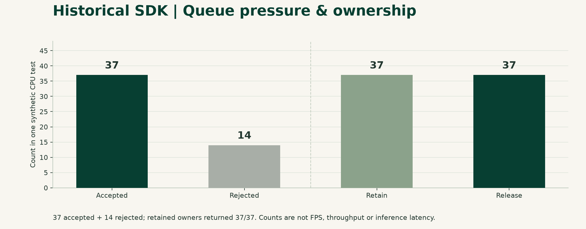

# Test observations / 测试观察与性能资料

[Documentation](README.md) · [English README](../README.md) · [中文 README](../README.zh-CN.md)

These figures visualize existing records. **No new device, inference or performance test was run to make these charts.** Source extraction validation and historical pre-extraction Release tests remain separate.

图表来自已有实测记录，本轮只整理数据、绘图，**没有重新执行设备、推理或性能测试**。源码提取验证和提取前的 SDK Release 测试分开。

Current interpretation: [MET-2 goals](PERFORMANCE_ACCEPTANCE.md) and [historical review](verification/sdk-metrics-review-20261026.md). Charts and original figures remain unchanged; they do not become resource-offload or production-throughput evidence by changing acceptance wording. / 图表及原数值保留，历史性能判断须结合新口径，未执行新测试。

## A. FrameBraid extraction / 独立提取验证

| Item / 项目 | Recorded result / 已记录结果 |
| --- | --- |
| Source / 来源 | `f05305fa9215e2c458f532ffe4697202a85b4dca` extraction baseline |
| Environment / 环境 | Windows x64 Debug, CPU; compatible native runtimes supplied |
| Rust tests / 单测 | 177 passed, 3 ignored, 8 filtered |
| DLL/script groups / 实调组 | 8 passed, including C/C++17/C#/Python |
| Core source identity / 核心同源 | 159 fingerprints checked |
| Scope / 范围 | Finite local verification, not a current Release, field or 24/7 acceptance |

The extraction initially failed without compatible native dependencies and passed after explicit runtime configuration. Full process logs are archived internally. Ignored/filtered tests are not counted as passing; script wall time is not model latency or video throughput. Later candidate results are in [current validation status](RELEASE_STATUS.md).

提取验证首次缺依赖失败，显式配置匹配运行库后通过；完整过程内部归档。忽略/过滤不算通过，脚本耗时不当模型延迟或视频吞吐。后续候选结果见当前验证状态。

## B. Historical SDK observations / 提取前 SDK 历史观察

The following Windows x64 CPU results predate FrameBraid extraction. The associated archive's Release build record identifies source `6078ebc9d18ed690c5769dc272db8c37bd1aed6d`; the selected per-run logs do not embed the exact binary fingerprint or CPU model. That association is context, not proof of per-run build identity. Do not cite these as current FrameBraid Release benchmarks.

以下为提取前 Windows x64 CPU 历史测试。归档中的 Release 构建记录指向上述提交，但选用单次日志没有记录准确 DLL 指纹和 CPU 型号，因此不声称每个日志与该构建严格绑定，也不标为当前 FrameBraid Release 性能。

### Reload stability / 装卸走势

| Metric / 指标 | Observation / 观察 |
| --- | --- |
| Reloads / 装卸轮数 | 30 |
| Warm-up / 预热 | First 5 cycles / 前 5 轮 |
| Post-warm-up / 后续测量 | 25 cycles / 25 轮 |
| Whole-process private-memory net growth / 进程私有内存净增 | 724,992 bytes = 0.69140625 MiB |
| Whole-process private-memory range / 进程私有内存波动范围 | 839,680 bytes over measured cycles |
| Process handles / 进程句柄 | 157 throughout all cycles / 全部轮次均为 157 |
| SDK workers after close / 关闭后 SDK worker | 0 in all recorded cycles / 全部记录均为 0 |
| SDK DLL unmapping / SDK DLL 卸载 | Both modules reported unmapped in all cycles / 两库每轮均报告已解除映射 |

Whole-process private memory is not SDK-only heap or RSS. ORT/FFmpeg may remain resident by design. First three cycles exercised 40 load/infer/close operations each; later cycles used one. This is a finite lifecycle observation, not proof of no leaks or a duration/load guarantee.

进程私有内存不等于 SDK 独占堆或 RSS，底层库按设计可常驻。前三轮各含 40 次装载/推理/关闭，之后各 1 次。有限结果不证明绝对无泄漏，也不保证长期负载。

### Queue pressure / 队列压力与拥有权

| Metric / 指标 | Observation / 观察 |
| --- | --- |
| Accepted / 接受请求 | 37 |
| Explicitly rejected / 明确拒绝 | 14 |
| Retain / 持有引用 | 37 |
| Release / 归还引用 | 37 |
| Fetch/release race iterations / 竞争验证次数 | 400 |

Rejection under configured pressure is an observed bounded-resource behavior, not necessarily a defect. Counts do not establish requests/second, per-image inference latency, camera capacity or a production success rate. Retain/release balance describes this test only.

设定压力下拒绝体现有界资源行为，不当然是缺陷。次数不等于 QPS、单帧延迟、路数或生产成功率；引用平衡只描述该次测试。

## Data and reproduction / 数据与复现

- [Sanitized observations](benchmarks/observations.json): selected numeric facts and original-log SHA-256, no private paths/credentials/customer images.
- [Reload CSV](benchmarks/reload-cycles.csv): all 30 selected measurements.
- [Chart generator](benchmarks/render_charts.py): Python with matplotlib; `python docs/benchmarks/render_charts.py` redraws charts without starting SDKs or accessing devices.
- Full internal logs remain in the owner's private archive, not published with the SDK. The included JSON/CSV lets readers reproduce each chart without that archive.

JSON/CSV 足够复画图表，完整内部日志不进公开源码；图表生成器不启 SDK、不连设备。

## Not measured here / 本资料未建立的指标

Inference median/P95/P99, sustained video FPS/bitrate/camera counts, end-to-end latency, CPU-versus-GPU comparison and long-duration behavior need a dedicated benchmark tied to an exact FrameBraid artifact and hardware/runtime/workload description. They are not invented or inferred from test-script times.

中位/P95/P99 推理延迟、持续 FPS/码率/路数、端到端延迟、CPU/GPU 对比及长稳，须针对准确 FrameBraid 制品与硬件/依赖/负载另测，不从脚本耗时推算。
